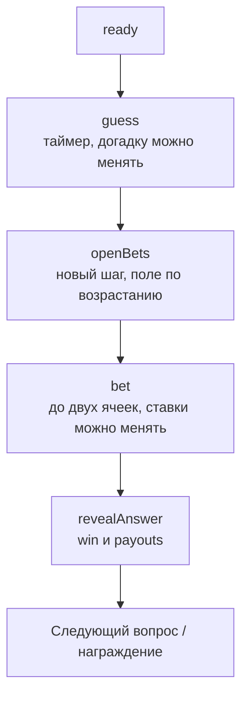

# Паспорт логики — Держи пари

> Перед правкой обязательны [`../LOGIC.common.md`](../LOGIC.common.md), этот паспорт, `wager.test.ts` и `importText.test.ts`.

- Составлен: 19.11.2026 по `main` после `1e6dd753`.
- Проверка: **16/16 тестов** (10 логика + 6 импорт); новых подтверждённых дефектов не найдено.
- Браузер, PostgreSQL, два реальных пульта и test/production отдельно не проверялись.

## 1. Правила

Команды или отдельные игроки отвечают числом, затем ставят фишки на самую близкую догадку. Общий экран обязателен;
в командах действует капитан. Числа принимают запятую и пробелы, слишком большие/нечисловые отбрасываются.

Старт — 2 фишки каждому, одна несгораемая. Выдача один раз отслеживается через `seeded`, включая опоздавших и старые
сессии без этого поля.

## 2. Схема вопроса

Поле объединяет одинаковые догадки в одну ячейку с несколькими авторами. При более чем 11 уникальных значениях
остаются 11 ближайших к середине. Коэффициенты 2:1 в центре, к краям выше; «меньше всех» — 6:1.

Выигрывает ближайшая догадка **не больше правильного ответа**. Если все больше — выигрывает специальная ячейка −1.
Если равных расстояний нет в коде отдельного правила, поле упорядочено и выбирается вычисленный `winningSlot`.

## 3. Ставки и выплаты

- Можно поставить максимум на две ячейки, каждая ставка не меньше 1; общий расход не больше запаса.
- При недостатке фишек ставки урезаются по порядку, несуществующие ячейки игнорируются.
- На выигрышной ячейке N при коэффициенте K превращается в `N×K`, изменение `+N×(K−1)`.
- На остальных ячейках ставка сгорает.
- Авторам выигравшей числовой догадки — `authorBonus`; у «меньше всех» авторов нет.
- Проигрыш не опускает счёт ниже одной фишки и не создаёт прибыль у нулевого/минимального счёта.

`payouts` хранит фактическое изменение после ограничения несгораемой фишки и используется для точного «Назад».

## 4. Экран, телефон, пульт

- **Экран:** вопрос, число написавших без самих чисел до раскладки, поле, коэффициенты, фишки и выигрыш.
- **Телефон:** догадка `{ guess }` и ставки `{ bets }`, изменяемые до закрытия этапа.
- **Пульт:** переходы, живой `liveProgress`, свежие ответы перед раскладкой/показом, следующий вопрос и «Назад».
  Механика сама управляет счётчиком ответов (`ownAnswered`).

Правильный ответ находится в обычном снимке игры; криптографической скрытности нет.

## 5. Инварианты

- **ДП-1.** Догадки/ставки учитываются только текущего шага и допустимого времени показа.
- **ДП-2.** Участвуют только записи таблицы; в команде — капитан.
- **ДП-3.** Стартовые фишки выдаются один раз каждому участнику.
- **ДП-4.** Одинаковые догадки объединяются; поле не больше 11 ячеек.
- **ДП-5.** Нельзя поставить на несуществующую ячейку или больше доступного запаса.
- **ДП-6.** Выигрыш соответствует правилу «ближе, но не больше»; иначе −1.
- **ДП-7.** Выплата — по коэффициенту, проигрыш сгорает, авторский бонус только авторам выигравшей догадки.
- **ДП-8.** Счёт никогда не ниже одной несгораемой фишки из-за проигрыша.
- **ДП-9.** `payouts` отражает фактически применённое изменение и полностью обратим.
- **ДП-10.** После «Назад» старые ставки не учитываются; догадки сохраняются с исходного показа.

## 6. «Назад» и повторы

- Из ответа: снимаются `payouts`, возвращаются ставки с возможностью изменения.
- Из ставок: новый показ догадок с исходным `guessStartedAt`, поле очищается, догадки остаются.
- Из догадок: заставка и очистка шага; повторный показ не выдаёт стартовые фишки снова.
- Из следующей заставки: ответ прошлого вопроса без изменения очков.
- С пьедестала — общий `podiumBack`.

Профильные тесты проверяют полную цепочку. Два реальных пульта и сетевое окно очистки ответов не прогонялись.

## 7. Связи и код

`content.ts`/`validate.ts`/`Editor.tsx` создают вопросы; `index.ts` регистрирует механику и `ownAnswered`.
`HostControls.tsx`/`logic.ts` создают `SessionChange`, общий сервер применяет права и `expect`. Очки пишет механика через
`scoreChange`; общий `score()` пустой. Завершение и результаты общие.

| Файлы | Ответственность |
|---|---|
| `content.ts`, `validate.ts`, `Editor.tsx` | Числа, поле, вопросы, настройки |
| `logic.ts` | Этапы, ставки, выплаты, возврат |
| `importText.ts` | Импорт вопросов |
| `HostControls.tsx`, `views.tsx` | Пульт, телефон, экран |
| `wager.test.ts`, `importText.test.ts` | 16 тестов |

Покрыты коэффициенты, поле, числа, полный вопрос, выплаты, меньше всех, пустая репетиция, шаблон, стартовые фишки,
старая сессия, несгораемая и возвраты. Не подтверждены большие группы, равные крайние случаи поля, два пульта,
PostgreSQL и мобильный браузер.

**Итог:** логика принята по 16 тестам; новых находок нет. Полный браузерно-серверный статус не присваивается.
