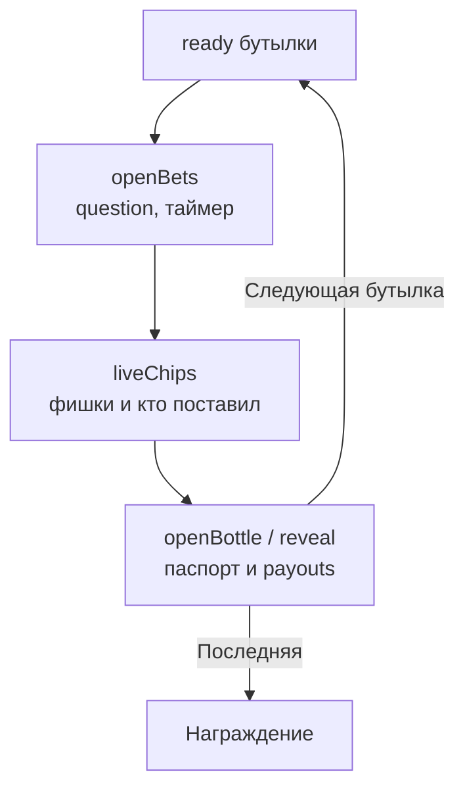

# Паспорт логики — Винное казино

> Перед правкой обязательны [`../LOGIC.common.md`](../LOGIC.common.md), этот паспорт и `wine.test.ts`.

- Составлен: 19.11.2026 по `main` после `1e6dd753`.
- Проверка: **6/6 тестов**; новых подтверждённых дефектов не найдено.
- Браузер, PostgreSQL, два реальных пульта и test/production отдельно не проверялись.

## 1. Правила

Игра 18+: гости ставят бесплатные фишки на цвет, Старый/Новый Свет, сладость, страну, сорт и год вина.
Поддерживаются одиночный и командный режимы; в команде ставит капитан. Проигрыш не вычитает очки.

На каждую бутылку выделяется `chips` фишек. Их можно распределить по допустимым ячейкам и менять до открытия.
За фишку на верной ячейке начисляется `chipValue × odds[category]`. Паспорт открывается только на `reveal`.

## 2. Схема

Год поля фиксируется при открытии ставок. Для вина вычисляются `winningKeys`: страна без учёта регистра, неизвестный
сорт — «Другой», ранний год — «Старше», отсутствующий — «Без года». Будущий год запрещает запуск по проверке.

## 3. Экран, телефон, пульт

- **Экран:** ставки по ячейкам, число поставивших и паспорт после открытия.
- **Телефон:** `{ chips: { key: count } }`, изменение до открытия. Допустимы только ключи текущего поля.
- **Пульт:** открытие ставок, живой счёт, открытие бутылки по ответам шага, следующая бутылка и «Назад».

Паспорт вина находится в обычном снимке игры и не является защищённым секретом от технически подготовленного гостя.

## 4. Инварианты

- **ВК-1.** Общая ставка участника не превышает `chips`; лишнее отбрасывается по порядку.
- **ВК-2.** Несуществующие ячейки, отрицательные и нечисловые значения не участвуют.
- **ВК-3.** Ответы только текущего шага и не раньше `startedAt`; после открытия ставки неизменны.
- **ВК-4.** Выплата только за верные ячейки, без отрицательного результата.
- **ВК-5.** Год/сорт/страна выбираются по единому `winningKeys` и присутствуют на поле.
- **ВК-6.** `payouts` полностью снимается «Назад»; повторное открытие не удваивает очки.
- **ВК-7.** Следующая заставка возвращает предыдущую бутылку без изменения её очков.

## 5. «Назад» и связи

Из открытой бутылки снимаются выплаты и открываются ставки; из ставок — заставка с очисткой шага; из следующей
заставки — предыдущий `prev`. С пьедестала — общий возврат.

Связь: `content.ts`/`validate.ts`/`Editor.tsx` → `gameSnapshot` → `HostControls.tsx`/`logic.ts` → общий сервер и таблица.
Очки пишет механика через `scoreChange`; общий `score()` пустой. Завершение общее.

## 6. Код и проверка

| Файлы | Ответственность |
|---|---|
| `content.ts`, `validate.ts`, `Editor.tsx` | Вина, поле, лимиты, возраст |
| `logic.ts` | Ставки, выплаты, возврат |
| `HostControls.tsx`, `views.tsx` | Пульт, телефон, экран |
| `wine.test.ts` | 6 тестов |

Подтверждены верные ключи, лимит фишек, выплаты по категориям, возврат, пустая репетиция, шаблон и будущий/отсутствующий
год. Не проверены реальные мобильные формы, два пульта, PostgreSQL и длинные названия стран/сортов.

**Итог:** логика принята по 6 тестам; новых находок нет. Полный браузерно-серверный статус не присваивается.
